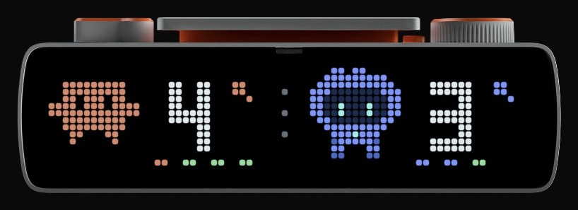
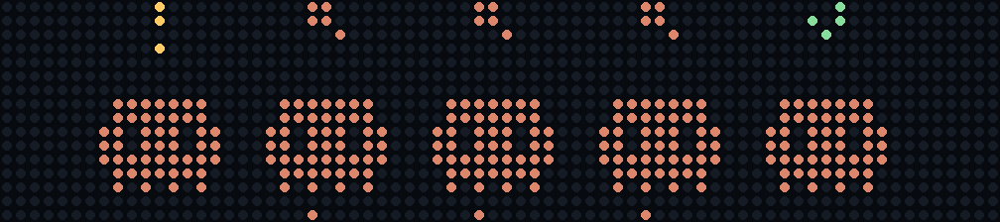
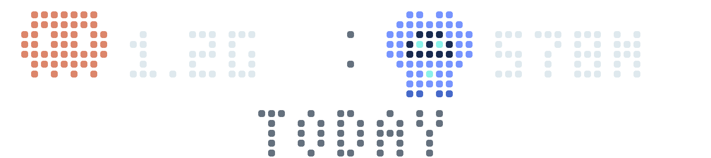
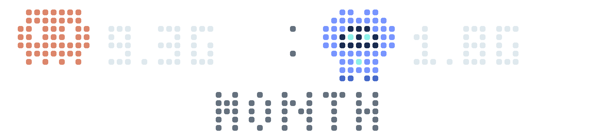

# Busy Crew

**See what your Claude Code and Codex agents are doing at a glance, on the LED strip of your [BUSY Bar](https://busy.app).** Each session is a little character: working, waiting for you, or done.

<p align="center">
  
</p>

Your Mac reads Claude Code and Codex activity locally and sends a 72 × 16 pixel frame to the bar. No conversation content leaves your Mac and no cloud service is involved. Busy Crew is an independent project, not affiliated with BUSY, Anthropic or OpenAI.

## What you see

When both families are active, the **duo** view above shows each family's count and up to four state dots. With only one family, each session gets its own character. Turn the scroll wheel to see the tokens your agents used.

<table>
  <tr>
    <td align="center"><br>Claude only</td>
    <td align="center"><br>Codex only</td>
  </tr>
  <tr>
    <td align="center"><br>Tokens today</td>
    <td align="center"><br>Tokens this month</td>
  </tr>
</table>

| On the bar | Meaning |
| --- | --- |
| Terracotta (Claude) or blue (Codex), legs moving | Working |
| Yellow `!` | Waiting for you: a question or a permission |
| Green `✓` | Finished, not yet acknowledged |
| Gray, `zzz` | Open but idle Claude session; `zzz` when all of them are |
| Gray `?` | Failed turn, unknown state or unreadable source |
| `+N` | More sessions than the six slots |

Token totals are shown in K (thousand), M (million) or G (billion) and include cache tokens. These captures are real: `uv run busy-crew snapshot --leds` on the author's bar.

## Requirements

- A Mac (macOS) and a [BUSY Bar](https://busy.app) on the same network
- Python 3.11+ and [uv](https://docs.astral.sh/uv/)
- [Claude Code](https://code.claude.com) and/or the [Codex app](https://openai.com/codex/), used on this Mac
- Optional: [ccusage](https://ccusage.com/) 20+ for the token views

## Quick start

```sh
git clone https://github.com/cmdai-hq/busy-crew.git
cd busy-crew
uv sync --locked
uv run busy-crew install --address http://busybar.local --timezone Europe/Paris
uv run busy-crew status
```

Use your bar's address. Your agents appear on the bar within a few seconds.

<details>
<summary>What <code>install</code> changes on your Mac</summary>

- **A LaunchAgent** (`local.busybar.agent-deck`) starts the collector at login and restarts it if it exits. It runs this checkout's Python environment, so **keep the repository folder where it is**.
- **Claude Code hooks**, added to Claude's settings after a private backup. They record only status identifiers and timestamps, never prompts, and never block Claude. Existing hooks and settings are preserved; a conflicting edit fails with recovery copies. Use `--no-claude-hooks` to rely on Claude's session registry alone, with coarser waiting and result detection.
- **A private state folder**, `~/Library/Application Support/BusyCrew`, for the configuration, backups and the log. Installations made before 1.0 keep `BusybarAgentDeck`.

Re-running `install` keeps the saved address and time zone unless you pass new ones. `uv run busy-crew uninstall` removes the LaunchAgent and the hooks, and keeps the state folder.
</details>

## Using it

| On the bar | Action |
| --- | --- |
| **Start / Pause** | Cycle: sessions → tokens today → tokens this month |
| **Scroll wheel**, turn | One view forward (+) or back (−) |
| **Scroll wheel**, press | Acknowledge the `✓` on screen |
| **Back** | Return to sessions |
| Selector on Off or Settings | Pause the display |

A session waiting for you always brings the sessions view back. No button answers a question or grants a permission: do that in Claude or Codex.

The same from the terminal:

```sh
uv run busy-crew view sessions   # or: tokens, month
uv run busy-crew ack             # acknowledge the results on screen
uv run busy-crew refresh         # recount tokens now
uv run busy-crew snapshot front.png --leds
```

A `✓` counts toward its family's total until you acknowledge it, the session starts new work, or it goes away (a closed Claude process, an archived Codex conversation, or a Codex response finished more than two hours ago). [How results and acknowledgment work](docs/how-it-works.md#results-and-acknowledgment).

**Optional:** a [menu bar icon](docs/menu-bar.md) shows whether the collector is running, why it isn't, and lets you acknowledge, refresh tokens or reload it.

## Configuration

`install` writes `config.json` in the state folder ([example](docs/config.example.json)):

| Key | Purpose |
| --- | --- |
| `address` | The bar's URL, e.g. `http://busybar.local` |
| `timezone` | Time zone for "today" and "this month" |
| `ccusage` | Absolute path to `ccusage`, if the LaunchAgent cannot find it |
| `token` | The bar's local API key, if LAN access requires one |

Over HTTP the key travels unencrypted: use a trusted network, or HTTPS if your device supports it. The busylib WebSocket SDK puts the key in a URL query and honors proxy environment variables; don't share those URLs or proxy logs.

`CLAUDE_CONFIG_DIR`, `CODEX_HOME` and `BUSY_CREW_STATE` (formerly `AGENT_DECK_STATE`, still honored) are supported; set them before installing, which pins them in the LaunchAgent and the hook command.

## Troubleshooting

Start with `uv run busy-crew status`.

- **The bar went dark:** check `status` first. The collector may have stopped, or it is running while the selector is on Off or Settings, or a higher-priority app owns the display. The [menu bar icon](docs/menu-bar.md) tells these apart at a glance.
- **Token views show `?`:** ccusage is missing or failed; sessions still work. Set `ccusage` in `config.json`.
- **`busy-crew` not found, or `invalid choice`:** you're running an older copy. `git pull --ff-only && uv sync --locked`, then use `uv run busy-crew` from the checkout. The pre-1.0 `agent-deck` command still works.

More, including Claude settings conflicts and recovery: [troubleshooting](docs/troubleshooting.md).

## How it works

- **Claude Code:** the session registry (`~/.claude/sessions`) gives each session, its state and its process; hooks sharpen "waiting for you" and finished results.
- **Codex:** the app's local SQLite databases and conversation logs, opened read-only.
- **Tokens:** one ccusage daily report from the 1st of the month, refreshed every two minutes.
- **The bar:** a frame through the BUSY Bar local API, with a 15-second lease so the bar recovers its own display if your Mac goes away.

Limits worth knowing: Codex approval requests are only partly visible, cloud tasks and other machines aren't tracked. Details: [how it works](docs/how-it-works.md), [tested versions](docs/COMPATIBILITY.md).

## Development

```sh
uv sync --locked
uv run python -m unittest discover -s tests -v
uv run busy-crew run              # run the collector in the foreground
uv run busy-crew demo /tmp/demo   # fictional previews of each layout
```

The tests never contact a device, run a model or touch your real agent data. CI runs them on macOS and Linux with Python 3.11 and 3.14. Verified on BUSY Bar firmware 1.2.4 (API 27.5.0). See [CONTRIBUTING](CONTRIBUTING.md) and [SECURITY](SECURITY.md).

## License

[MIT](LICENSE). Contributions are welcome; see [CONTRIBUTING](CONTRIBUTING.md).

The characters are drawn in code, inspired by Clawd and Codex. References: [BUSY Bar developer docs](https://docs.busy.app/bar/dev), [busylib](https://github.com/busy-app/busylib-py), [Claude Code hooks](https://code.claude.com/docs/en/hooks), [ccusage](https://ccusage.com/).
