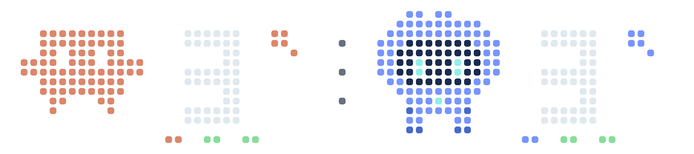

# BUSY Bar · Agent Deck

A small crew of **terracotta Clawd characters** and **blue Codex characters** on the BUSY Bar's front LED matrix. Your Mac monitors local sessions and sends a **72 × 16 pixel** bitmap once a second when it changes.

## A view that follows your team

**Both Claude and Codex sessions are being tracked → Duo.** Large characters appear alongside the session count for each agent family, including open, idle Claude sessions.



**Only one agent family is present → Small team.** Each small character represents a real session. A Claude session remains visible when its response finishes, then turns gray once acknowledged, as long as its process remains open. It also keeps its place while another session is working.


**All open Claude sessions are idle → `zzz`.** The character stays visible while its process is open, even if Codex is still working.


These images are simulated examples generated by `agent-deck demo docs`. The program never uses them as tracking data.

| Indicator | State |
| --- | --- |
| Terracotta or blue; animated legs in the team view | Session working |
| Yellow `!` | Interaction required, when the event is observable |
| Green `✓` | Response completed while the monitor was running, not yet acknowledged |
| Gray / `zzz` | Open, idle Claude sessions; the family sleeps when all are idle |
| Gray `?` | Unknown state or unavailable source; no fabricated session count |
| `+N` | Additional sessions beyond the six available slots |

Sessions requiring interaction appear first. A completed response keeps its character and a green check mark. Once acknowledged, an open Claude session remains visible in gray; a completed Codex conversation is removed from tracking. There is no custom display on the rear screen.

## Installation on macOS

Requirements: Python 3.11+, [uv](https://docs.astral.sh/uv/), and Claude Code and/or the Codex app with their local data. [ccusage](https://ccusage.com/) 20+ is optional for token tracking. The tested version is 20.0.26, using the `daily --by-agent` report.

```sh
git clone https://github.com/tristanbes/busybar-agent-deck.git
cd busybar-agent-deck
uv sync --locked
uv run agent-deck install --address http://busybar.local --timezone Europe/Paris
uv run agent-deck status
```

Replace the example address with your own bar's URL. `install` adds a macOS LaunchAgent that starts at login, restarts the program if it exits, and uses this repository's Python environment. **Keep the repository folder at this location.** Reinstallation preserves the configured address and time zone unless the corresponding option is supplied.

It also adds status hooks to Claude's settings after creating a private backup. Existing hooks, permissions, and settings are preserved; conflicting edits fail with recovery copies. A settings symlink is refused before modification. The hooks run with isolated Python imports and make no decisions for Claude: they store only status/interaction identifiers and timestamps, without prompts or network access, and exit with code 0. For an already open Claude session, check that they appear in `/hooks`; restarting that session ensures the new configuration is loaded. The native session registry already provides activity data without waiting for these hooks.

To use only passive data sources:

```sh
uv run agent-deck install --no-claude-hooks
```

This removes Agent Deck's owned hooks from an existing installation while preserving third-party hooks. `CLAUDE_CONFIG_DIR`, `CODEX_HOME` and `AGENT_DECK_STATE` are supported; set them before installing. The effective paths are pinned in the LaunchAgent and the hook command so launching Claude from another shell does not split its status across runtimes.

To stop the program and remove only its hooks and LaunchAgent:

```sh
uv run agent-deck uninstall
```

Backups and local files are kept in `~/Library/Application Support/BusybarAgentDeck` (or `AGENT_DECK_STATE`). This folder is outside the repository. The private `config.json` file lets you specify the address, time zone, and path to `ccusage`, as well as a `token` if the bar's local connection requires a key. [Example configuration](docs/config.example.json). No BUSY cloud access is used. HTTP leaves the key unencrypted in transit: use a trusted device network, or HTTPS if your device supports it. REST redirects are refused. The pinned busylib WebSocket SDK sends the key in a URL query and can use environment proxies; do not share those URLs or proxy logs, and review your proxy environment before starting the service.

## Controls on the bar

| Control | Action |
| --- | --- |
| Start | Toggle between sessions and tokens |
| Scroll wheel toward + / toward − | Tokens / sessions |
| Back | Return to sessions |
| OK | Acknowledge visible completion indicators; no acknowledgment from the tokens view |
| Selector set to Off or Settings | Pause the Agent Deck display |

When interaction is required, the sessions view stays on screen even if the tokens view was selected. No button grants a permission or sends a reply to an agent.

The same controls are available from the terminal:

```sh
uv run agent-deck view tokens
uv run agent-deck view sessions
uv run agent-deck ack
uv run agent-deck snapshot front.png --leds
```

`snapshot` reads the framebuffer from the actual bar; it is not a physical photograph of the LEDs.

## Tokens

The tokens view shows today's totals **by agent family**, refreshed every two minutes and displayed in K or M. It uses ccusage's `totalTokens`, including cache tokens as reported by that tool. It does not show an instantaneous rate, context size, or remaining subscription quota. No cost is extrapolated for a model without known pricing. An error, stale data, or a change of day produces a `?`.

## Tracking sources and limitations

**Claude CLI**: `~/.claude/sessions/*.json` provides the identity, busy/idle state, and process lifetime. The PID and its UTC start time are checked to exclude closed processes and reused PIDs. The `PermissionRequest`, `AskUserQuestion`, and `Elicitation` hooks identify waits for interaction; `PostToolUse` and `UserPromptSubmit` indicate that work has resumed. Subagents do not increase the main session count. Only sessions in the native registry are counted; CLI variants that do not appear there require another adapter.

Permission requests lack tool IDs in Claude's documented schema. Agent Deck correlates them with a unique preceding tool call using an input hash, storing only that hash and the call ID. Identical concurrent calls and notifications/elicitation events without a usable identity remain unknown instead of guessing which interaction was resolved. The payload contents are never persisted.

**Codex Mac / local sessions**: read-only access to `~/.codex/state_5.sqlite`, `thread_history_1.sqlite`, and rollout events. The latest turn of each user conversation is used; archived conversations and subagents are excluded. If the rollout already contains a newer root turn than SQLite, the previous completion is cleared and the session remains unknown until the sources agree. Old incomplete turns are not counted: an `inProgress` turn with no local writes for 15 minutes is discarded. This threshold avoids ghost sessions, but can also hide a very long, silent turn or an extended wait.

Activity in this Codex chat was verified locally; completion and question transitions are covered by tests using controlled events. Synchronous question detection uses rollout events when available. **These files do not expose every approval request from the Codex app: yellow indicators for Codex provide only partial coverage.** An asynchronous question does not incorrectly mark a still-active session as waiting. Codex's internal databases and formats can change: a read incompatibility displays a `?` without modifying the app's data. Tasks orchestrated in the cloud and sessions on other machines are not tracked.

At its first startup, the monitor ignores old completed responses. It persists new unacknowledged results across monitor restarts, until acknowledgment or new work; notifications disappear when their source session is closed or unavailable. A transition to idle alone does not establish a successful response. A source error does not reuse the last known count. Bitmaps have a 15-second lease; the loop targets a renewal every 5 seconds, subject to observation and I/O delays. If the Mac or program becomes unavailable, the firmware lease expires. A higher-priority application can take over; the program does not raise its priority to displace it, and cleanup is scoped to Agent Deck.

The program reads the local files needed for tracking and ccusage, but does not copy them into the repository or send any conversation content to the bar. It sends only pixels. It does not change the bar's brightness, network, or WARP settings. See [compatibility and distribution notes](docs/COMPATIBILITY.md) for the tested contracts and dependency licenses.

## Troubleshooting and recovery

Run `uv run agent-deck --version` and `uv run agent-deck status` first. Status omits conversation identifiers and reports source, input and device errors separately. Check the private runtime log when the service cannot start; redact local paths and secrets before sharing diagnostics. `ccusage` is optional: its failure affects the tokens view, not session monitoring.

If Claude settings contain invalid JSON, a symlink, or an unexpected structure, fix that file yourself before installing with hooks; the installer refuses to replace it. A fresh passive installation does not touch unrelated Claude settings. For a reported concurrent edit, close writers and inspect the private copies in the runtime's `recovery` folder. If settings are on another volume, recovery copies are kept beside them in a private `.agent-deck-recovery` folder because atomic exchange requires the same filesystem. Compare copies with the current Claude settings, then merge only the intended changes. Do not overwrite the entire file with an old backup while Claude or an editor is changing it. Re-run install after resolving the conflict. A filesystem without atomic-exchange support is refused without falling back to an unsafe replacement.

An installation failure attempts to restore the previous configuration, plist and service. Any rollback failure is reported with recovery files retained. An uninstall error means the stop was not confirmed: retain the plist/runtime files and resolve the launchctl error before retrying. Runtime backups and acknowledgment data remain after uninstall; delete that private folder yourself once you no longer need it. To move the checkout or environment, uninstall using the old environment, move it, sync dependencies, then reinstall.

Real macOS login/restart, sleep/wake, device disconnect/reconnect and selector state at startup require testing on a dedicated account/device. Those scenarios are not established by the synthetic suite.

## Development and verification

```sh
uv sync --locked
uv run python -m unittest discover -s tests -v
uv run agent-deck run
```

Tests cover installation conflicts and rollback, hook import isolation, JSON/schema failures, result identities and restarts, waiting interactions, acknowledgment visibility, reconnects, tokens and native-size rendering. CI runs them on Linux and macOS with Python 3.11 and 3.14 and builds/smoke tests an installed wheel outside the checkout. The tests do not contact any device or run any model. See [CONTRIBUTING](CONTRIBUTING.md) and [SECURITY](SECURITY.md).

Hardware integration verified on BUSY Bar firmware **1.2.4**, API **27.5.0**: XPM writes and exact readback of the front framebuffer in BGR888. The sprites are drawn in code, inspired by Clawd and the blue character chosen in the preview; this project is independent of the products involved.

## License and contributions

Agent Deck is source-available under the [PolyForm Noncommercial License 1.0.0](LICENSE). Use and modifications are subject to the permitted purposes and full terms in that license. Use outside those permitted purposes requires separate permission from the applicable rights holders. The restriction applies to commercial uses, not just resale.

Forks, bug reports, and pull requests for permitted purposes are welcome. Contributions are submitted under the same license; see [CONTRIBUTING.md](CONTRIBUTING.md). Dependencies retain their own licenses.

References: [BUSY Bar firmware](https://github.com/busy-app/busybar-firmware), [busylib Python SDK](https://github.com/busy-app/busylib-py), [Claude Code hooks](https://code.claude.com/docs/en/hooks), [Codex hooks](https://learn.chatgpt.com/docs/hooks), [ccusage](https://ccusage.com/).
