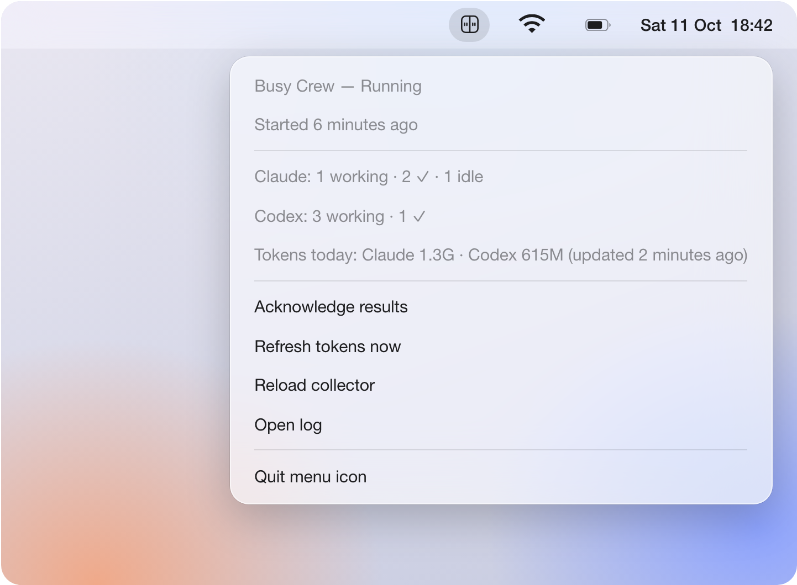

# Menu bar icon

<p align="center">
  
</p>

This optional macOS menu bar icon shows the collector's health and offers common actions. When the service stops, its 15-second display lease expires and the bar returns to its own display.

```sh
xcode-select --install                 # once, for the Swift compiler
busy-crew menubar install
busy-crew menubar uninstall
```

`menubar install` compiles a small AppKit app (`agentdeck/menubar/BusyCrewMenu.swift`) into the private runtime folder. It then starts the app with its own LaunchAgent (`local.busybar.agent-deck.menubar`) at login. A failed compile or start leaves any previous version in place. `busy-crew uninstall` also removes the icon.

| Icon | Meaning |
| --- | --- |
| `xmark.circle` | Stopped: no fresh `status.json` (missing, invalid, or older than 10 s) |
| `exclamationmark.triangle` | Degraded: the bar is unreachable, a source cannot be read, or the bar's buttons are disconnected |
| `arrow.clockwise.circle` | Update available: a newer release is out, the collector's code changed on disk since it started, or the running collector predates health reporting |
| `pause.circle` | Paused by the bar's selector |
| The duo: a square split into two faces with two eyes each | Running |

**Running** describes the collector, not who owns the bar's screen. A higher-priority app can cover Busy Crew's frame without changing this icon.

The menu shows health reasons, the start time, session counts and today's token totals with their last refresh time.

| Action | Effect |
| --- | --- |
| Acknowledge results | Same as pressing the scroll wheel; enabled when results can be acknowledged |
| Refresh tokens now | Starts a background ccusage recount; it can take up to 45 seconds |
| Update to X | Upgrades Homebrew/uv installs, preserving settings, then refreshes the collector and menu app |
| Reload collector | Restarts the collector and loads configuration changes |
| Open log | Opens the private service log |

Update output is saved in `upgrade.log`. A checkout shows manual update instructions instead of **Update to X**.

**Quit menu icon** closes the icon until your next login. A token (`ccusage`) failure appears as a note and does not degrade the icon.

The icon reads `status.json` every 5 seconds and when you open the menu; its size depends on the session count. The icon never reads agent sources or contacts the bar itself. Its update action launches the package manager; the collector checks GitHub for releases ([privacy](privacy.md)).

Use `busy-crew upgrade` for package updates. For passive tracking, check the [older installation case](installation.md#updates-and-removal) first. After a manual package update, run `busy-crew install` and `busy-crew menubar install`; repeat `--no-claude-hooks` for passive tracking.

In a checkout, **Reload collector** is enough for Python-only changes. Run `uv sync --locked` first if dependencies changed. See [installation and updates](installation.md#updates-and-removal).
